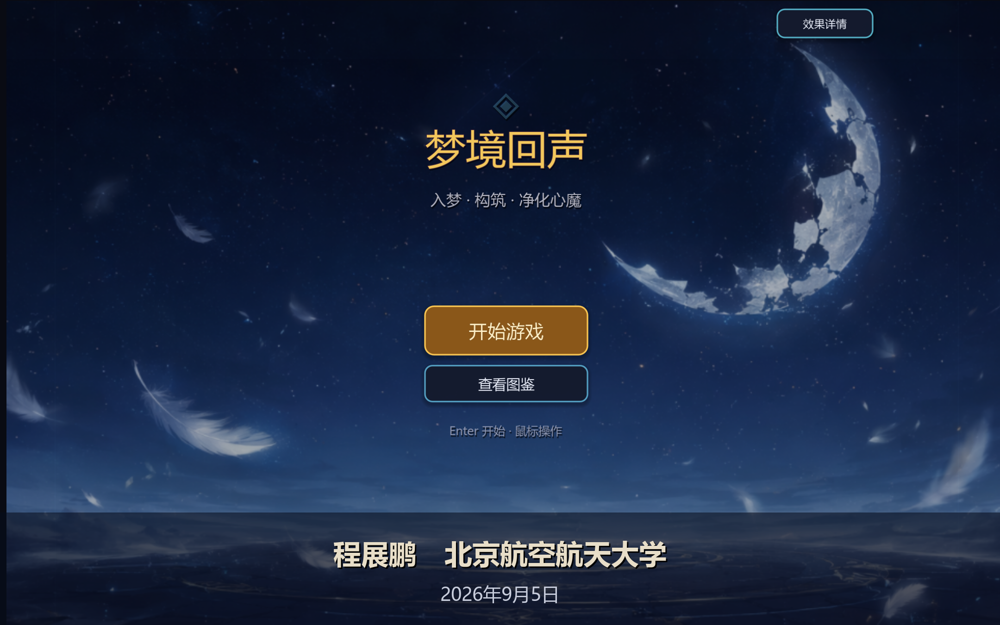

# 梦境回声 · Dream Echo

> 北京航空航天大学 · 大二上小学期《程序设计实践》课程作业
> 梦境题材 2D 回合制肉鸽（Roguelike）闯关游戏 · Godot 4 + GDScript



## 项目信息

| 项目 | 内容 |
| --- | --- |
| 作品名 | 梦境回声（Dream Echo） |
| 类型 | 2D 回合制肉鸽闯关 / 卡牌构筑 |
| 引擎 | Godot 4.7.2（GDScript） |
| 课程 | 大二上小学期 · 程序设计实践 |
| 作者 | 程展鹏 |
| 提交日期 | 2026-09 |

## 游戏简介

玩家扮演“入梦师”潜入他人梦境，沿着梦境航线逐格推进，用节点卡构筑路线、招募同伴、分配装备，
击败镇守心魔与最终首领，完成净化。一局结束后获得局外货币“回声碎片”，用于永久解锁新的入梦师。

一局的核心循环：

1. **选人**：从已解锁的入梦师中组队（前台 3 人 / 后台 3 人）
2. **构筑航线**：13 格路线，每局随机获得 6 张初始节点卡，抵达空格时从卡组选一张放下
3. **进节点**：战斗 / 精英 / 首领 / 奇遇 / 商店 / 休息 / 奖励，不同类型不同结算
4. **滚雪球**：3 张同类型同等级节点卡合成 1 张更高等级的卡，等级越高敌人越强、奖励越好
5. **结算**：通关或阵亡后获得回声碎片，回到局外解锁新角色

## 运行方法

1. 下载 [Godot 4](https://godotengine.org/download/windows/)（选 **Standard 标准版**，不要选 .NET/Mono 版）
2. 打开 Godot → 项目管理器 → **导入（Import）**
3. 选择本仓库根目录下的 `project.godot`
4. 按 **F5** 或点击右上角 ▶ 运行

首次打开时 Godot 会自动导入美术与音频资源，约需 1 分钟；窗口按 2160×1350 启动，支持窗口缩放。

## 已实现内容

- 单层 13 格梦境航线：自选×3 → 精英 → 自选×3 → 精英 → 自选×4 → 首领
- 9 名入梦师（4 名初始 + 5 名探索招募），前台 3 人 / 后台 3 人，战斗中可换人
- 节点卡构筑：3 张同类型同等级卡合成 1 张高一级卡，节点等级动态影响敌方强度与奖励品质
- 回合制战斗：攻击 / 技能 / 药品 / 卷轴，敌上我下的棋盘界面，可点选攻击目标
- 敌方阵容：镇守（多个心魔）、精英（带随从）、强化首领（双随从）
- 装备系统：每名角色 3 个通用装备位，装备带击杀回能、带盾增伤、治疗转护盾等被动
- 奇遇系统：安全离开 / 未知尝试 / 条件洞察三段式抉择，含梦蚀、记忆残片与连续事件
- 商店、休息、奖励节点，金币与探索等级驱动成长
- 局外存档：`user://save.json` 记录回声碎片与角色解锁进度
- 梦境图鉴：角色、技能、被动、道具、装备、心魔、节点卡片全量查询

## 技术实现

| 维度 | 说明 |
| --- | --- |
| 代码规模 | 29 个 GDScript，约 8,300 行；13 个场景 |
| 数据驱动 | 角色、敌人、装备、事件模板与平衡数值集中在 `scripts/game_data.gd` |
| 状态管理 | `run_state.gd`（局内）、`meta.gd`（局外）、`audio_man.gd` 三个 Autoload 单例 |
| UI | 全部用代码构建主题与控件（`ui_theme.gd` / `ui_bar_view.gd` / `ui_texture_view.gd`），无预制 UI 场景 |
| 美术管线 | 生成式 AI 出图 → `tools/crop_asset_sheets.py` 批量裁切九宫格 → `art/ready_v2` 运行时资源 |
| 自适应 | `canvas_items` 拉伸模式 + 2160×1350 基准分辨率 |

## 目录结构

```
2026-xiaoxueqiWork/
├─ project.godot            # Godot 工程配置
├─ export_presets.cfg       # 导出预设
├─ scenes/                  # 13 个场景（main / map / battle / select / codex…）
├─ scripts/                 # 29 个 GDScript（game_data / run_state / battle_scene…）
├─ art/ready_v2/            # 运行时美术资源：角色、心魔、背景、图标、节点、UI 框
├─ audio/                   # 2 首 BGM + 2 个音效
├─ tools/crop_asset_sheets.py  # 美术源表批量裁切脚本
├─ video_cover.png          # 标题界面截图（本文件顶部封面）
└─ docs/                    # 设计文档与制作记录
```

## 设计文档

- [答辩 PPT](docs/答辩PPT_梦境回声_程展鹏_v5.pptx)
- [游戏 UI 设计思路](docs/游戏UI设计思路.docx)
- [个人设计思路](docs/个人设计思路.doc)
- [美术制作需求清单](docs/制作记录/美术制作需求清单.md)
- [设计与制作记录](docs/制作记录/)（生图指令、导出指南、后续设计备忘）

## 演示视频

视频体积 65 MB，未直接放入仓库，请在 **Releases** 页或网盘查看：

> 🎬 演示视频：https://github.com/xiaomu0714/2026-xiaoxueqiWork/releases （发布 Release 后在此查看）

## 声明

本仓库为课程作业提交物，仅供学习交流使用。美术资源由生成式 AI 辅助制作并后期裁切整理。
